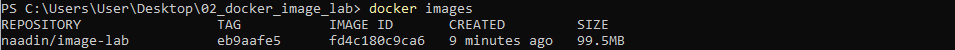
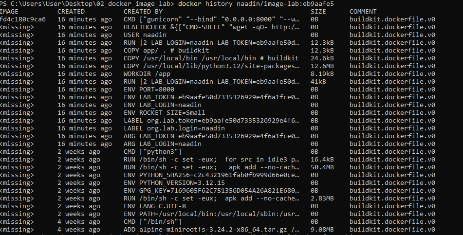
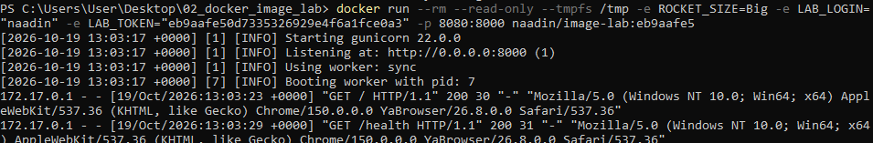

# lab_2

Ссылка на образ в Docker Hub:
https://hub.docker.com/r/naadin/image-lab/tags

## Размер образа

## История

## Вывод
Благодаря использованию образа `python:3.12-alpine`, размер итогового образа составил 99.5Мб. Это значительно меньше «наивной» сборки на базе полного `python:3.12`. 

В целях безопасности контейнер запускается от имени непривилегированного пользователя naadin, а не от root. Кроме того, добавлен HEALTHCHECK, который каждые 30 секунд проверяет эндпоинт /health и на основе результата устанавливает статус контейнера. 

Контейнер успешно работает в режиме --read-only (флаг --tmpfs /tmp добавляет временную директорию в оперативную память).

Конфигурация передается через переменные окружения и build-args, поэтому для изменения поведения приложения не требуется пересборка образа. Использование Gunicorn вместо встроенного сервера Flask обеспечивает корректное и быстрое завершение по сигналу SIGTERM.
